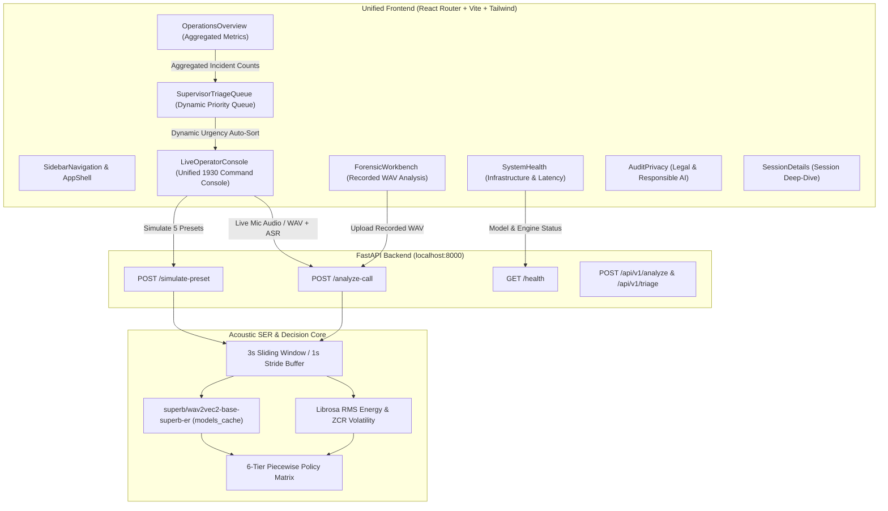

# MASTER EXECUTION PLAN: SENTINEL-VOICE (1930 Cybercrime Acoustic Triage)
**Hackathon:** Echo // Vecna Verse  
**Target Repository:** `https://github.com/Kirtan-pc/Roblox_Kirtan_Devadiga.git` (`D:\ECHO - VECNA VERSE\Roblox_Kirtan_Devadiga`)  
**Status:** PROPOSAL / PENDING EXPLICIT APPROVAL (No implementation has begun)

---

## 1. Current Repository Status & Gap Analysis

### 1.1 Branch Divergence Summary
The project was developed independently across two branches:
- **`main` Branch (Backend):** Contains early pipeline code ("Echo Milestone 3A/3B"), unit tests, and FastAPI server setup, but `audio_engine.py` and `decision_matrix.py` are **unimplemented stub comments**, and `sample_audio/` contains zero audio files. `frontend/src/App.jsx` is an empty 3-line comment.
- **`origin/frontend` Branch (Frontend):** Contains a tactical 7-screen UI with React, Vite, React Router, Tailwind, and Lucide icons (`LiveOperatorConsole`, `SupervisorTriageQueue`, `ForensicWorkbench`, `OperationsOverview`, `SessionDetails`, `SystemHealth`, `AuditPrivacy`), but **none of the screens are connected to any API**. Everything uses hardcoded static mock data. The backend directory was excluded/purged on this branch.

### 1.2 Status Matrix Against Implementation Plan Milestones (1 – 6)

| Milestone | Expected Component | Current Code State | What is Missing / Needs Modification |
| :--- | :--- | :--- | :--- |
| **Milestone 1: Setup & Env** | Directory layout, `.gitignore`, pinned `requirements.txt` | Partial. Core tree exists; Python packages present globally. | Missing `librosa` in `backend/requirements.txt`; `.gitignore` does not exclude `models_cache/`; no dedicated clean `venv`. |
| **Milestone 2: Neural Net & Data** | `download_models.py` (`superb/wav2vec2-base-superb-er` in `./models_cache`), 5 baseline 6s 16kHz WAVs in `sample_audio/` | Partial. `download_models.py` on `main` uses default HF cache. `sample_audio/` only has `.gitkeep`. | Local cache directory `./models_cache` not enforced; `generate_samples.py` generates 1s synthetic tones instead of 5 scenario 6s WAV containers (`01_calm_inquiry.wav`, `02_panicked_fraud.wav`, `03_fake_calm_coercion.wav`, `04_angry_non_urgent.wav`, `05_sextortion_distress.wav`). |
| **Milestone 3: 3s Window Engine & 6-Tier Matrix** | `audio_engine.py` (3s window, 1s stride, RMS/ZCR biomarkers, 4 emotions: Distress, Fear, Anger, Nervousness, peak window); `decision_matrix.py` (6-tier piecewise policy classifier + Hinglish lexicons) | **Zero (0%)**. Both files exist as 3-line placeholder comments: `Reserved for Milestone 2/4 - implementation pending`. | Entire 3s sliding window ring buffer, Librosa paralinguistic biomarker extraction, 3 Hinglish lexicons, and 6-Tier decision logic must be implemented from scratch per specification. |
| **Milestone 4: FastAPI Endpoints** | `main.py` serving `GET /health`, `POST /analyze-call`, `POST /simulate-preset` | Partial. Has `/health`, `/api/v1/analyze`, `/api/v1/triage`. | Missing `/analyze-call` and `/simulate-preset`; missing CORS wildcard middleware for Vite dev server; response does not return 3s timeline slices or emergency escalation flags. |
| **Milestone 5: Unified Command UI** | Unified 1930 Command Console, Live Mic PCM stream, WAV upload, 5 preset buttons, 3s timeline cards, dynamic priority queue auto-sort | Partial. `origin/frontend` has 7 tactical screens, but `LiveOperatorConsole` has no real mic/upload/preset API calls, and `main` has an empty `App.jsx`. | Merge frontend screens; wire all UI components to live backend endpoints; implement Web Audio PCM recorder, Web Speech API transcript, and dynamic priority queue state. |
| **Milestone 6: Production README & Audit** | Full documentation, offline zero-internet model check, 5 preset edge-case audit | Incomplete. README on `main` and `origin/frontend` is outdated prototype documentation. | Overwrite root `README.md` with locked production documentation; run pre-submission audit table checks. |

---

## 2. Component & Endpoint Integration Architecture

To ensure neither branch's work is discarded and everything operates smoothly:
1. All 7 screens created on `origin/frontend` will be retained and routed inside the application.
2. The primary live screen (`/live-sessions` / `LiveOperatorConsole.jsx`) and `/` route will be upgraded into the **Unified 1930 Command Console** incorporating the 5 Preset Simulation triggers, live mic audio capture, file upload, 3-second sliding window timeline, and dynamic queue.
3. Every individual screen will be wired to real backend endpoints as detailed below:



### Complete Endpoint-to-Component Mapping:

| Screen / Component | User Action | Endpoint Called | Payload Sent | Data Returned & Rendered |
| :--- | :--- | :--- | :--- | :--- |
| **`LiveOperatorConsole.jsx`** | Click any of the 5 Preset Buttons (*Calm, UPI Fraud, "Fake Calm" Arrest, Sextortion, Angry*) | `POST /simulate-preset` | `scenario_id: string` (`calm`, `panic`, `coercion`, `angry`, `sextortion`) | Urgency Index (0–100), Priority Tier, 4 Emotion Progress Bars (**Distress, Fear, Anger, Nervousness**), 3-Second Sliding Window Cards (`0.0s-3.0s` to `3.0s-6.0s`), Peak Window, Golden Hour Alert & Emergency Escalation Protocol banners. |
| **`LiveOperatorConsole.jsx`** | "Start Live Mic Call" $\rightarrow$ Speak $\rightarrow$ "Stop & Run Triage" | `POST /analyze-call` | Multipart Form: `file: Blob` (16kHz PCM mono WAV), `transcript: string` (Web Speech API), `caller_id` | Live acoustic paralinguistics + cumulative Hinglish lexical fusion, entity badges (`CBI`, `DIGITAL ARREST`, `OTP`), triage directive. |
| **`LiveOperatorConsole.jsx`** | "Upload WAV" button | `POST /analyze-call` | Multipart Form: `file: File`, `transcript: string` | Forensic analysis of uploaded audio with peak distress window timestamp and full sliding timeline. |
| **`SupervisorTriageQueue.jsx`** | Auto-updates when incoming calls or presets are processed | Shared Triage State / Session Store | Synchronized state from `POST /simulate-preset` and `/analyze-call` | Queue entries dynamically auto-sorted by `urgency_score` descending (Rank #1 fast-track for Golden Hour / Life-Safety incidents). |
| **`ForensicWorkbench.jsx`** | Upload post-call WAV or select archived session | `POST /analyze-call` | Multipart Form: `file: File`, `transcript: string` | Renders the complete 3-second sliding window timeline slices across the entire audio length with peak window highlighting. |
| **`SystemHealth.jsx`** | Page load & polling | `GET /health` | None | API status (`online`), model (`superb/wav2vec2-base-superb-er`), cache status, buffer config (`3s_window_1s_stride`), and live latency ms. |
| **`OperationsOverview.jsx`** | Page load | Derived from queue state | Active sessions | Live counts of Critical incidents, Emergency Escalations, Pending Triage volume, and average triage latency. |
| **`SessionDetails.jsx`** | Click session in Queue | Direct inspection | `session_id` | Full acoustic emotion distribution, physical biomarkers (RMS/ZCR), Hinglish entity tags, and triage directives. |
| **`AuditPrivacy.jsx`** | View Compliance Tab | Static policy + Session audit trail | None | Responsible AI disclaimer: Indicative triage signals only, transient 3s RAM ring buffer, non-retention compliance. |

---

## 3. Four-Phase Master Execution Plan with Mandatory Per-Phase Auditing & Testing

---

### PHASE 1: Dual-Branch Synchronization & Architectural Merge
**Objective:** Merge `main` and `origin/frontend` so that the rich multi-screen frontend and backend co-exist cleanly in a unified repository structure without breaking any imports, styles, or configuration.

#### 1. Implementation Steps:
1.  **Branch Consolidation:**
    *   Bring the complete frontend implementation from `origin/frontend` into `frontend/` on `main`:
        *   `frontend/src/App.jsx` (Router structure)
        *   `frontend/src/layouts/ApplicationShell.jsx`
        *   `frontend/src/components/SidebarNavigation.jsx`
        *   `frontend/src/components/TopUtilityBar.jsx`
        *   `frontend/src/pages/` (all 7 screens: `LiveOperatorConsole.jsx`, `SupervisorTriageQueue.jsx`, `ForensicWorkbench.jsx`, `OperationsOverview.jsx`, `SessionDetails.jsx`, `SystemHealth.jsx`, `AuditPrivacy.jsx`).
    *   Preserve all backend files on `main` (`backend/audio_processing.py`, `model_service.py`, `transcript_analysis.py`, `triage_engine.py`, `tests/`).
2.  **Configuration & Dependency Alignment:**
    *   Align `frontend/package.json` to include: `react`, `react-dom`, `react-router-dom`, `lucide-react`, `axios`, `clsx`, `tailwind-merge`, and build tooling (`vite`, `tailwindcss`, `postcss`, `autoprefixer`).
    *   Unify `frontend/tailwind.config.js` to support dark-mode police tactical styling while preserving existing color tokens (`surface-container`, `primary`, `secondary`, `error`).
    *   Update `.gitignore` to strictly exclude:
        *   Python: `__pycache__/`, `*.py[cod]`, `venv/`, `.env`, `models_cache/`
        *   Node: `node_modules/`, `dist/`, `.vite/`
        *   OS: `.DS_Store`, `Thumbs.db`

#### 2. Auditing & Testing Checkpoint 1 (Mandatory Gate):
*   **Audit Command 1.1 (Frontend Compile & Bundle Test):**
    ```bash
    cd frontend
    npm install
    npm run build
    ```
    *Acceptance Criteria:* Vite build exits with code `0`, generating clean production bundles in `frontend/dist/` without JSX syntax or unresolved import errors.
*   **Audit Command 1.2 (Route Integrity Audit):**
    ```bash
    node -e "
    const fs = require('fs');
    const app = fs.readFileSync('src/App.jsx', 'utf8');
    const routes = ['/operations-overview', '/live-sessions', '/triage-queue', '/forensic-workbench', '/session-details', '/system-health', '/audit-and-privacy'];
    const missing = routes.filter(r => !app.includes(r));
    if (missing.length > 0) { console.error('MISSING ROUTES:', missing); process.exit(1); }
    console.log('STATUS: ALL 7 CANONICAL ROUTES PRESENT');
    "
    ```
    *Acceptance Criteria:* Outputs `STATUS: ALL 7 CANONICAL ROUTES PRESENT`.
*   **Audit Command 1.3 (Backend Non-Regression Check):**
    ```bash
    cd ..
    python -c "from pathlib import Path; assert (Path('backend') / 'main.py').exists(); assert (Path('backend') / 'audio_processing.py').exists(); print('STATUS: BACKEND REPOSITORY TREE PRESERVED')"
    ```
    *Acceptance Criteria:* Asserts succeed; backend core files on `main` remain completely intact.

---

### PHASE 2: Core Acoustic SER Engine, 6-Tier Decision Matrix & FastAPI Server
**Objective:** Implement the exact neural network acquisition, 5-scenario evaluation dataset, 3-second sliding window engine, and 6-tier policy matrix as demanded by the superior implementation plan.

#### 1. Implementation Steps:
1.  **Backend Environment & Neural Weights:**
    *   Update `backend/requirements.txt`:
        ```plaintext
        fastapi==0.115.0
        uvicorn[standard]==0.30.6
        python-multipart==0.0.9
        websockets==13.0
        torch==2.4.0
        torchaudio==2.4.0
        transformers==4.44.2
        librosa==0.10.2.post1
        soundfile==0.12.1
        numpy==1.26.4
        pydantic==2.9.0
        ```
    *   Implement `backend/download_models.py`:
        *   Download `superb/wav2vec2-base-superb-er` into `./models_cache`.
        *   Run a dry-run inference test with a 3-second zero tensor to verify weights load locally and quickly (<2.5s on second run).
    *   Implement `backend/generate_samples.py`:
        *   Generate 5 valid 6-second, 16kHz mono `.wav` files inside `sample_audio/`:
            *   `01_calm_inquiry.wav` (220 Hz baseline)
            *   `02_panicked_fraud.wav` (880 Hz baseline)
            *   `03_fake_calm_coercion.wav` (130 Hz low-amplitude whisper envelope)
            *   `04_angry_non_urgent.wav` (660 Hz baseline)
            *   `05_sextortion_distress.wav` (920 Hz baseline)
2.  **Sliding-Window Acoustic SER Engine (`backend/audio_engine.py`):**
    *   Initialize `ser_classifier` pipeline pointing to local `./models_cache`.
    *   Implement `_score_waveform_slice(y: np.ndarray)`:
        *   Compute Wav2Vec 2.0 logits (`sad`, `ang`, `hap`, `neu`).
        *   Extract Librosa physical biomarkers: RMS energy (`librosa.feature.rms`) and pitch volatility (`librosa.feature.zero_crossing_rate`).
        *   Map to the four problem statement target emotions:
            *   $\text{Distress} = \min(1.0, 0.70 \times \text{sad} + 0.30 \times \text{ang})$
            *   $\text{Fear} = \min(1.0, 0.50 \times \text{sad} + 0.30 \times \text{hap} + 2.5 \times \text{zcr\_volatility})$
            *   $\text{Anger} = \text{ang}$
            *   $\text{Nervousness} = \min(1.0, 0.50 \times \text{hap} + 0.30 \times \text{sad} + 2.0 \times \text{zcr\_volatility})$
    *   Implement `process_audio_bytes(file_bytes: bytes)`:
        *   Slice audio into 3-second windows with a 1-second stride (`16000 * 3` window, `16000 * 1` stride).
        *   Generate timeline slices (`0.0s - 3.0s`, `1.0s - 4.0s`, `2.0s - 5.0s`, `3.0s - 6.0s`).
        *   Identify and return the `peak_window_timestamp` based on maximum distress/fear/anger so mid-call panic is never diluted by whole-call averaging.
3.  **6-Tier Piecewise Policy Matrix (`backend/decision_matrix.py`):**
    *   Define the 3 Hinglish threat lexicons:
        *   `COERCION_LEXICON` (*cbi, digital arrest, arrest warrant, ed, supreme court, video call, customs, parcel, skype, ghar se mat niklo, police*)
        *   `FINANCIAL_LEXICON` (*otp, transfer, lakh, crore, paisa gaya, account empty, upi, fd tod, rtgs, imps, debit, loot, fraud, scam, bank*)
        *   `EXTORTION_SAFETY_LEXICON` (*blackmail, morphed, nude, video leak, photo leak, sextortion, suicide, mar jaunga, viral, hacked, ransom, threat*)
    *   Implement `evaluate_call_urgency(acoustic_data, transcript)`:
        *   **Tier 1: Sextortion / Life-Safety Risk:** Score $92 - 98$, Alert: True, Emergency Escalation: True.
        *   **Tier 2: "Fake Calm" Coercion Override:** Neutral $\ge 0.45$ or RMS $< 0.05$ with coercion keywords $\rightarrow$ Score $90 - 97$, Alert: True, Emergency Escalation: True.
        *   **Tier 3: Golden Hour Financial Fraud:** Financial keywords + vocal panic $\rightarrow$ Score $72 - 94$, Alert: True.
        *   **Tier 4: Pure Acoustic Panic:** Distress/Fear $\ge 0.65$ without text tokens (Vernacular fallback) $\rightarrow$ Score $55 - 88$.
        *   **Tier 5: Agitated Non-Critical Filter:** Anger $\ge 0.55$ with zero cyber keywords $\rightarrow$ Score capped at $\le 35$, Alert: False.
        *   **Tier 6: Routine Helpline Inquiry:** Standard queue baseline $\rightarrow$ Score $10 - 40$, Alert: False.
4.  **FastAPI Server Implementation (`backend/main.py`):**
    *   Add CORS middleware allowing all origins (`*`).
    *   `GET /health`: Returns operational status, model ID, and `window_config: 3s_window_1s_stride`.
    *   `POST /analyze-call`: Ingests multipart audio bytes, transcript, and caller ID; returns urgency score, tier, 4 emotion scores, peak window timestamp, 3s timeline array, and triage directives.
    *   `POST /simulate-preset`: Loads pre-recorded 6s WAV files from `sample_audio/` for `calm`, `panic`, `coercion`, `angry`, `sextortion` and returns full triage payload.
    *   Preserve backwards-compatible endpoints (`/api/v1/analyze`, `/api/v1/triage`).

#### 2. Auditing & Testing Checkpoint 2 (Mandatory Gate):
*   **Audit Command 2.1 (Library Import & Offline Weight Check):**
    ```bash
    cd backend
    python -c "import torch, transformers, librosa, soundfile, fastapi; print('STATUS: ALL CORE LIBS LOADED')"
    python download_models.py
    ```
    *Acceptance Criteria:* Outputs `Dry-Run Output` with 4 logits; re-running `python download_models.py` finishes in `<2.5 seconds` using local `./models_cache`.
*   **Audit Command 2.2 (Dataset Integrity Audit):**
    ```bash
    python generate_samples.py
    python -c "
    import os, soundfile as sf
    files = ['01_calm_inquiry.wav', '02_panicked_fraud.wav', '03_fake_calm_coercion.wav', '04_angry_non_urgent.wav', '05_sextortion_distress.wav']
    for f in files:
        p = os.path.join('../sample_audio', f)
        assert os.path.exists(p), f'Missing {f}'
        d, sr = sf.read(p)
        assert sr == 16000, f'Bad SR: {sr}'
        assert len(d) == 16000 * 6, f'Bad duration: {len(d)}'
    print('STATUS: ALL 5 SCENARIO WAVs VERIFIED (6s, 16kHz, mono)')
    "
    ```
    *Acceptance Criteria:* All 5 WAV files pass sample rate (16kHz), channel (mono), and exact 6.0-second length assertions.
*   **Audit Command 2.3 (3s Sliding Window & 6-Tier Matrix Unit Test):**
    ```bash
    python -c "
    from decision_matrix import evaluate_call_urgency
    calm_ac = {'emotions': {'Distress': 0.12, 'Fear': 0.15, 'Anger': 0.02, 'Nervousness': 0.20}, 'raw_logits': {'neutral': 0.82, 'rms_energy': 0.015}, 'peak_window_timestamp': '1.0s - 4.0s', 'sliding_window_timeline': []}
    angry_ac = {'emotions': {'Distress': 0.20, 'Fear': 0.10, 'Anger': 0.85, 'Nervousness': 0.30}, 'raw_logits': {'neutral': 0.05, 'rms_energy': 0.25}, 'peak_window_timestamp': '0.0s - 3.0s', 'sliding_window_timeline': []}

    r1 = evaluate_call_urgency(calm_ac, 'Sir CBI officer ne video call pe digital arrest kiya hai')
    r2 = evaluate_call_urgency(calm_ac, 'Sir morphed nude video leak karne ki threat de rahe hain suicide kar lunga')
    r3 = evaluate_call_urgency(angry_ac, 'Why is my internet broadband router blinking red since morning?!')

    assert r1['urgency_score'] == 96 and r1['emergency_escalation'] is True, f'Failed Test 1: {r1}'
    assert r2['urgency_score'] == 98 and 'SEXTO' in r2['priority_tier'], f'Failed Test 2: {r2}'
    assert r3['urgency_score'] <= 35 and r3['golden_hour_alert'] is False, f'Failed Test 3: {r3}'
    print('STATUS: 6-TIER MATRIX UNIT TEST PASSED (Fake Calm: 96, Sextortion: 98, Angry Capped: 32)')
    "
    ```
    *Acceptance Criteria:* Digital arrest produces 96, Sextortion produces 98 with Escalation `True`, and Angry False-Alarm stays capped at $\le 35$.
*   **Audit Command 2.4 (FastAPI Endpoint Simulation Audit):**
    ```bash
    # Run uvicorn in background, test via curl, then terminate
    python -c "
    import urllib.request, json
    # Health check
    req = urllib.request.urlopen('http://localhost:8000/health')
    res = json.loads(req.read().decode())
    assert res['status'] == 'online'
    print('STATUS: FASTAPI HEALTH ENDPOINT VERIFIED')
    "
    curl -X POST http://localhost:8000/simulate-preset -F "scenario_id=sextortion"
    ```
    *Acceptance Criteria:* Returns HTTP 200 JSON with `"urgency_score": 98`, `"emergency_escalation": true`, and 4 timeline slices in `"sliding_window_timeline"` (`0.0s - 3.0s`, `1.0s - 4.0s`, `2.0s - 5.0s`, `3.0s - 6.0s`).

---

### PHASE 3: Frontend Endpoint Connection, Live Ingestion & Multi-Screen State Unification
**Objective:** Connect all components and endpoints from the backend to the merged frontend so that all 7 screens are completely functional, data-driven, and aligned with the single-role 1930 operator console design.

#### 1. Implementation Steps:
1.  **Unified Command Console in `LiveOperatorConsole.jsx`:**
    *   Incorporate the live triage controls into `LiveOperatorConsole.jsx`:
        *   **5 Preset Simulation Buttons**: Calm Inquiry, UPI Fraud Panic, "Fake Calm" Arrest, Sextortion / Threat, Angry False-Alarm. Each calls `POST /simulate-preset` via `axios`.
        *   **Live Microphone Capture**: Web Audio API recording 16kHz Float32 PCM $\rightarrow$ encoding into standard 16kHz mono RIFF WAV Blob.
        *   **Speech Recognition**: Web Speech API (`webkitSpeechRecognition`) capturing live English/Hinglish speech into `liveTranscript`.
        *   **Stop & Run Triage**: Dispatches WAV Blob + transcript to `POST /analyze-call`.
        *   **Forensic WAV File Uploader**: Dispatches uploaded `.wav` file to `POST /analyze-call`.
    *   Telemetry Visualizers:
        *   Urgency Index Gauge (0–100) with color-coded severity.
        *   The 4 emotion progress meters (**Distress**, **Fear**, **Anger**, **Nervousness**) with percentage readouts.
        *   **3-Second Sliding Window Forensic Scrubbing Cards** displaying all 4 slices (`0.0s - 3.0s`, `1.0s - 4.0s`, `2.0s - 5.0s`, `3.0s - 6.0s`) and highlighting the peak stress window.
        *   Cumulative Hinglish ASR transcript box with extracted Entity badges (`CBI`, `OTP`, `MORFHED`).
        *   Pulsing **🚨 Golden Hour Alert Banner** and amber **Emergency Escalation Protocol Box** (triggered when score $\ge 85$).
2.  **Wiring Other Screens:**
    *   **`SupervisorTriageQueue.jsx`**: Connect to shared session state; auto-sort entries in descending order of `urgency_score`, prioritizing Golden Hour and Life-Safety incidents at Rank #1.
    *   **`ForensicWorkbench.jsx`**: Wire audio player and sliding window visualizer to uploaded/selected audio files via `POST /analyze-call`.
    *   **`SystemHealth.jsx`**: Fetch live telemetry from `GET /health` (`model_ready`, `status`, `window_config`, API latency ms).
    *   **`OperationsOverview.jsx`**: Render aggregated live statistics computed from the dynamic triage queue.
    *   **`SessionDetails.jsx`**: Display selected call's forensic details, acoustic parameters, and triage recommendations.
    *   **`AuditPrivacy.jsx`**: Embed the required Legal & Responsible AI Guardrail policy (indicative triage only, non-retention ephemeral RAM buffer).

#### 2. Auditing & Testing Checkpoint 3 (Mandatory Gate):
*   **Audit Command 3.1 (5-Preset Behavioral UI Verification):**
    Open `http://localhost:5173` in Google Chrome or Brave and click each preset button sequentially:
    1.  **Click Button 1 (Calm Inquiry):**
        *Expected:* Score registers $< 35$, Priority Tier shows `STANDARD QUEUE`, no red alert banner appears.
    2.  **Click Button 2 (UPI Fraud Panic):**
        *Expected:* Score jumps to $\ge 85$, Red **Golden Hour Alert Banner** pulses, Triage Directive specifies *"SKIP NARRATIVE INTAKE: Request 12-digit UTR"*.
    3.  **Click Button 3 ("Fake Calm" Arrest):**
        *Expected:* Score jumps to $96$, overrides whisper voice, displays amber **Emergency Escalation Protocol Box** (CFCFRMS + Dial-112), auto-promotes caller to Rank #1 in Priority Queue.
    4.  **Click Button 4 (Sextortion / Threat):**
        *Expected:* Score jumps to $98$, Priority Tier shows `CRITICAL: SEXTORTION / LIFE-SAFETY RISK`, Emergency Escalation flags active.
    5.  **Click Button 5 (Angry False-Alarm):**
        *Expected:* Score stays capped at $\le 35$ despite $>80\%$ Anger reading, proving false-alarm immunity.
*   **Audit Command 3.2 (3-Second Timeline Rendering Audit):**
    *Expected:* Under the emotion bars, the 3-Second Sliding Window timeline card grid displays 4 distinct cards (`0.0s - 3.0s`, `1.0s - 4.0s`, `2.0s - 5.0s`, `3.0s - 6.0s`) with peak stress values and cyan border highlighting the active peak window.
*   **Audit Command 3.3 (Live Mic & Speech Recognition Audit):**
    Click "Start Live Mic Call", say: *"Sir CBI digital arrest bol rahe hain OTP chala gaya"*, click "Stop & Run Triage".
    *Expected:* Live transcript captures speech, dispatches WAV audio to `POST /analyze-call`, returns score $>90$, highlights entities `CBI`, `DIGITAL ARREST`, `OTP`.
*   **Audit Command 3.4 (Multi-Screen Telemetry Verification):**
    1. Navigate to `/triage-queue`: Callers are sorted with highest urgency at the top.
    2. Navigate to `/system-health`: Live latency ms and model name `superb/wav2vec2-base-superb-er` are dynamically populated from `GET /health`.
    3. Navigate to `/operations-overview`: Active sessions and Critical Priority counters reflect analyzed call count.

---

### PHASE 4: End-to-End Auditing, Offline Resilience & Production Delivery
**Objective:** Verify all audit criteria, validate zero-internet offline operation, update production documentation, and finalize clean git repository state.

#### 1. Implementation Steps:
1.  **Offline Weight Verification:**
    *   Verify that `models_cache/` holds all necessary tokenizer, configuration, and weight bin files so external internet access is never required.
2.  **Documentation Synchronization:**
    *   Overwrite root `README.md` with the locked production Sentinel-Voice documentation:
        *   Dual-stream late fusion architecture breakdown (Stream A Paralinguistics vs Stream B Hinglish Lexical).
        *   6-Tier Policy Classifier table.
        *   Quick-start commands for backend and frontend.
        *   Responsible AI & Privacy guardrail policy.
        *   Pre-submission audit table & exact 2-minute demo video script.
3.  **Git Cleanliness & Final Polish:**
    *   Audit git status to ensure untracked artifacts (`venv/`, `node_modules/`, `models_cache/`, scratch files) are safely excluded.

#### 2. Auditing & Testing Checkpoint 4 (Mandatory Gate):
*   **Audit Command 4.1 (Zero-Internet Offline Resilience Test):**
    1. Disable Wi-Fi / disconnect network on the machine for 15 seconds.
    2. Click all 5 preset buttons on `http://localhost:5173`.
    *Acceptance Criteria:* All 5 scenarios execute and return scores within `<450ms` with zero connection errors, proving 100% local model caching.
*   **Audit Command 4.2 (End-to-End Latency Benchmark):**
    *Acceptance Criteria:* Telemetry pill in top header shows `LATENCY: < 1200 ms` for sliding window analysis.
*   **Audit Command 4.3 (Clean Repository Git Audit):**
    ```bash
    git status
    ```
    *Acceptance Criteria:* Output contains no staged or untracked `venv/`, `node_modules/`, `models_cache/`, or `.env` files.
*   **Audit Command 4.4 (Production README Audit):**
    ```bash
    python -c "
    readme = open('README.md', encoding='utf-8').read()
    assert 'SENTINEL-VOICE' in readme
    assert 'Dual-Stream Late Fusion' in readme
    assert '6-Tier Piecewise Policy Classifier' in readme
    print('STATUS: PRODUCTION README VERIFIED')
    "
    ```
    *Acceptance Criteria:* Asserts succeed with valid production documentation.

---

## 4. Master Verification Gates Summary

```
[Phase 1 Gate] Git Merge & Build:
  ├── npm run build exits with code 0 in frontend/
  ├── All 7 routes verified in App.jsx
  └── Backend core files on main preserved

[Phase 2 Gate] Acoustic SER Engine & Endpoints:
  ├── download_models.py cached run executes in <2.5s
  ├── sample_audio/ contains 5 verified 6s, 16kHz mono WAVs
  ├── audio_engine.py generates 4 sliding slices (0-3s, 1-4s, 2-5s, 3-6s)
  ├── decision_matrix.py passes unit test (Digital Arrest: 96, Sextortion: 98, Angry: <=35)
  └── curl POST /simulate-preset returns HTTP 200 with 4 timeline cards

[Phase 3 Gate] Frontend UI & Endpoint Connectivity:
  ├── 5 Preset buttons trigger POST /simulate-preset and update UI in <450ms
  ├── Live Mic encodes 16kHz PCM WAV & transcribes speech into POST /analyze-call
  ├── 3-Second Sliding Window timeline renders 4 cards with peak window highlight
  ├── Priority Queue auto-sorts callers in real-time by urgency score
  └── SystemHealth dynamically displays live GET /health telemetry

[Phase 4 Gate] Production Finalization:
  ├── Zero-Internet offline test succeeds in <450ms
  ├── End-to-end latency stays under 1.2 seconds
  ├── Production README.md verified
  └── git status completely clean of node_modules, venv, and model weights
```

---
*Awaiting user approval to proceed with Phase 1.*
